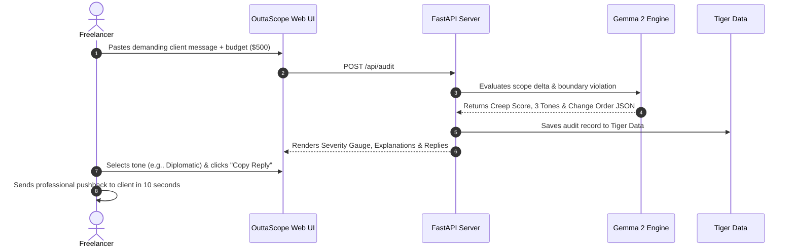

# 📋 Product Requirements Document (PRD)
## OuttaScope — Client Scope Creep & Revision Shield

- **Document Version:** 1.0.0
- **Status:** Approved / Active
- **Target Release:** Hacktoberfest Open-Source AI Challenge: Week 2 (Side Hustle)
- **Product Owner:** OuttaScope Core Team

---

## 1. Executive Summary

### 1.1 Problem Statement
Freelance side-hustlers, digital creators, and independent contractors routinely lose 20–30% of their billable capacity to unbilled client revisions, late-night feature requests, and scope creep. Because solo creators fear damaging client relationships or appearing confrontational, they frequently succumb to revision spirals, delivering thousands of dollars in unpaid labor.

Furthermore, pasting client confidential briefs, proprietary specifications, and private messages into proprietary cloud LLMs (such as ChatGPT) creates severe legal risks, violating Non-Disclosure Agreements (NDAs) and confidentiality clauses.

### 1.2 Mission & Vision
**OuttaScope** provides modern freelancers with an open-source, privacy-preserving boundary defense system. By combining Google's open-weight **Gemma 2** model with **Tiger Data** persistence, OuttaScope analyzes incoming client revision messages, evaluates contractual breach severity (0–100 Creep Score), and instantly generates tailored, non-confrontational boundary responses paired with mathematically fair change-order invoices.

---

## 2. Target Personas

### 2.1 Persona A: "Leo" — Gen Z Video Editor & Shorts Clipper
- **Profile:** Edits YouTube videos, TikToks, and podcasts for creators and digital agencies.
- **Pain Point:** Client says: *"I don't feel the vibe of this cut, can you do 8 completely different versions with new music and effects by tonight?"*
- **Behavior:** Leo spends 45 minutes agonizing over a reply, feels guilty, and stays up until 4:00 AM working for free.
- **Desired Outcome:** One-click polite pushback that says: *"Glad you want to explore more styles! Additional creative rounds are +$75 each."*

### 2.2 Persona B: "Sarah" — Full-Stack Web Developer
- **Profile:** Builds custom Next.js/FastAPI web apps and Shopify stores ($2,000–$5,000 milestones).
- **Pain Point:** Client demands: *"Before launch, can we also squeeze in user authentication, a referral dashboard, and Stripe payouts?"*
- **Behavior:** Sarah knows this is 30+ hours of extra engineering but lacks an objective, formal Change Order framework.
- **Desired Outcome:** An executive-level Change Order delta notice with line-item estimates and schedule extensions.

### 2.3 Persona C: "Maya" — Brand Identity & UI Designer
- **Profile:** Delivers logos, style guides, and Figma design systems.
- **Pain Point:** Client insists on: *"Let's completely start over with a neon dark-mode palette after Phase 1 sign-off."*
- **Desired Outcome:** Instant contract boundary audit citing the milestone agreement and quoting a Phase 2 add-on.

---

## 3. Product Features & Scope

### 3.1 Feature Matrix

| ID | Feature Name | Description | Priority |
| :--- | :--- | :--- | :---: |
| **FR-1** | **Scope Ingestion Engine** | Ingests client chat text, project service niche (Web, Video, Design, Copy), and agreed milestone budget. | P0 |
| **FR-2** | **Creep Meter (0–100)** | Computes numerical severity score with Infraction Classification (MILD, MODERATE, HIGH, CRITICAL). | P0 |
| **FR-3** | **Multi-Tone Pushback Synthesis** | Synthesizes 3 distinct response tones: Diplomatic & Collaborative, Firm Boundary, and Executive Change Order. | P0 |
| **FR-4** | **Change Order Estimator** | Automatically calculates recommended add-on fee ($USD) and schedule extension (+Days). | P0 |
| **FR-5** | **Zero-Leak Privacy Sandbox** | Powered by Gemma 2 open weights. Runs locally or in isolated private instances with zero model training retention. | P0 |
| **FR-6** | **Tiger Data Boundary Vault** | Stores audit history and pre-configured canned boundary templates for quick copy-pasting. | P1 |
| **FR-7** | **Interactive 1-Click Samples** | Preloaded chips simulating real-world toxic client scenarios for instant testing and demonstrations. | P1 |

---

## 4. User Journey & Workflow

---

## 5. Non-Functional Requirements (NFRs)

- **Performance & Latency:** Sub-1.5 second audit turnaround time.
- **Privacy & Compliance:** 0% telemetry of client message content to third-party ad networks or closed AI training loops.
- **Offline Resilience:** Deterministic heuristic fallback engine guarantees 100% uptime even if external LLM endpoints are unreachable.
- **Accessibility & UX:** Responsive across all screen sizes (mobile, tablet, desktop) with full WCAG AA contrast compliance.

---

## 6. Business & Monetization Model (Side Hustle Alignment)

- **Free Community Edition (Open Source):** Full local inference via Ollama + Render self-hosted blueprint.
- **Pro Hosted Tier ($9/month):**
  - Unlimited cloud audits with Gemma 2.
  - Multi-client team workspaces.
  - Direct integration with Slack, WhatsApp Web, and Gmail.
- **Value Metric:** At $9/month, saving just one $150 revision loss yields an instant **1,600% ROI** for the freelancer.
