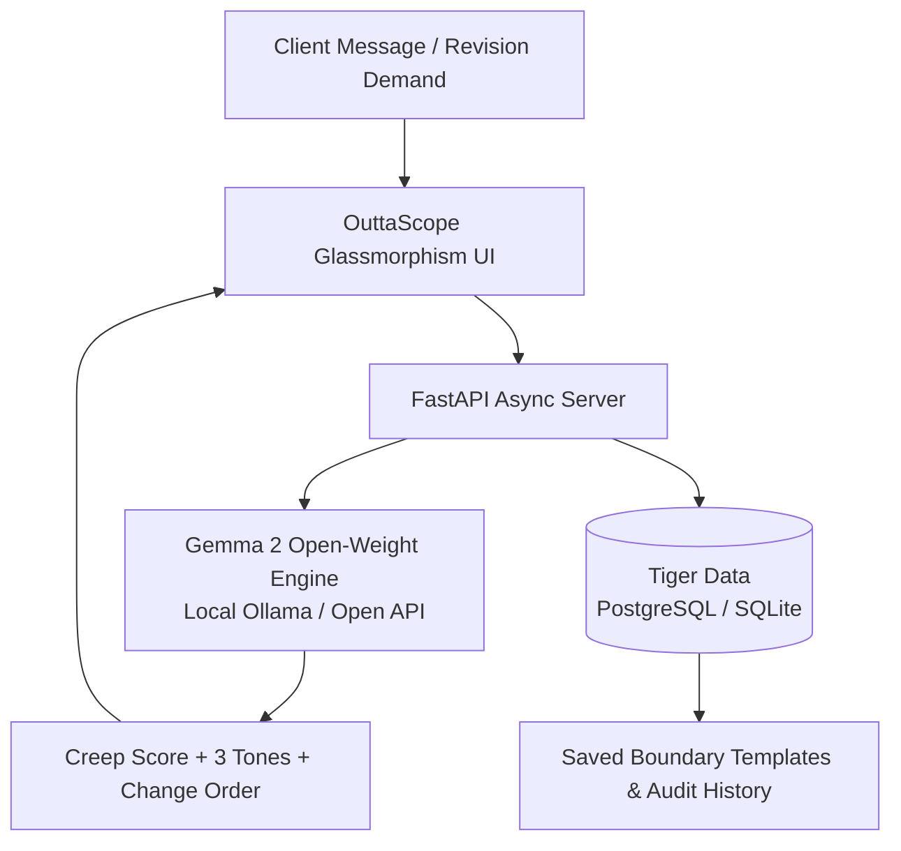

# 🛡️ OuttaScope — The Client Scope Creep & Unpaid Revision Shield

[](https://ai.google.dev/gemma)
[](https://www.tigerdata.com/)
[](https://render.com)
[](LICENSE)

> **Build for the [Hacktoberfest Open-Source AI Challenge: Week 2 (Side Hustle)](https://dev.to/challenges/hacktoberfest-week2-2026-10-12)**.  
> *Protecting freelance side hustles from unpaid revision spirals and late-night scope creep.*

---

## 💥 The Real-World Pain Point

Every developer, freelance video editor, and designer has experienced that Sunday 11:30 PM WhatsApp message:

> *"Hey, loved the work! But can we completely overhaul the layout, switch to dark mode, and add a custom Stripe checkout before 9 AM tomorrow? Shouldn't take long, right?"*

**The brutal reality:** Side hustlers don't fail because their work is bad—they fail because they do **30+ hours of free, unbilled revisions** because they feel awkward or confrontational saying: *"That costs extra."*

Furthermore, pasting client confidential briefs, proprietary specifications, and private messages into proprietary cloud LLM APIs **violates client confidentiality and NDA agreements**.

---

## ⚡ Solution: What OuttaScope Does

**OuttaScope** is an open-source, zero-leak boundary defense assistant that converts awkward revision pushbacks into billable revenue:

1. **🚨 Instant Creep Meter & Letter-Grade Risk Radar (A–F):**
   Categorizes the violation (e.g., *Architectural Overhaul*, *Feature Creep*, *Timeline Compression*, or *Infinite Aesthetic Loop*) with itemized contractual red flags and negotiation advice.
2. **💬 3 Non-Confrontational Reply Tones:**
   - **🟢 Diplomatic & Collaborative:** Enthusiastically accepts the vision while quoting a clear add-on fee and timeline extension.
   - **🟡 Firm Boundary:** Professionally pauses the revision spiral, insisting on shipping agreed milestone deliverables before quoting Phase 2.
   - **🔴 Executive Change Order:** Contract-ready legal change order notice suitable for enterprise clients and agencies.
3. **📲 1-Click WhatsApp & Email Direct Dispatch:**
   Push back immediately via WhatsApp Web/Mobile (`api.whatsapp.com`) or native mail client (`mailto:`) with pre-formatted pushback copy in one click.
4. **💰 Revenue Recovered & Hours Rescued Live Tracker:**
   Persistent real-time tally in the header tracking cumulative dollars and billable hours rescued across client audits.
5. **🐯 Tiger Data Semantic Precedent Matching & Vault:**
   Calculates semantic Jaccard overlap against past client scope infractions, displaying historical similarity rates, previous fee quotes, and a canned template library.
6. **📎 Drag-and-Drop Brief Extractor:**
   Directly drag and drop client brief files or screenshots into the audit scratchpad for automatic text extraction.
7. **📑 Instant Change Order Mini-Invoice:**
   Automatically calculates a mathematically fair surcharge (e.g., `+$175`) and timeline extension based on the milestone budget.
8. **🔒 100% Zero-Leak Privacy:**
   Powered by **Google's Gemma 2** open-weight model. Client project conversations are audited locally and privately without being fed into commercial training sets.

---

## 🏗️ Architecture & Open Tech Stack



- **Open AI Foundation:** [Gemma 2](https://ai.google.dev/gemma) (Google Open Weights)
- **Data Persistence:** [Tiger Data](https://www.tigerdata.com/) (PostgreSQL / SQLite fallback)
- **Application Core:** Python 3.11+, FastAPI, Uvicorn, Pydantic
- **Web Interface:** React 18, Vite, Tailwind CSS, Hand-Drawn Sketchpad Aesthetic (Kalam & Patrick Hand typography, paper textures, tactile physics)
- **Cloud Deployment:** [Render](https://render.com) (Free Web Service Tier via `render.yaml`)
- **Reliability:** GitHub Actions 12-min Keep-Alive Heartbeat (sub-second cold start prevention)

### 📚 Formal Engineering Specifications
- 📋 [**Product Requirements Document (PRD.md)**](PRD.md) — Personas, user journeys, feature matrix & business metrics.
- ⚙️ [**Technical Requirements Document (TRD.md)**](TRD.md) — System architecture, API contracts, Gemma 2 pipeline & data schemas.
- 🎨 [**Design Specification (DESIGN.md)**](DESIGN.md) — UI design system, color tokens, layout wireframes & accessibility standards.

---

## 🚀 Quickstart & Local Installation

### 1. Clone & Install
```bash
git clone https://github.com/sachinn-alt/outtascope.git
cd outtascope
pip install -r requirements.txt
```

### 2. Run the Application
```bash
python -m uvicorn src.app:app --host 127.0.0.1 --port 8000 --reload
```
Open your browser to: **`http://localhost:8000`**

### 3. Optional: Run with Local Gemma 2 (Ollama)
```bash
# Pull and serve Gemma 2 completely offline:
ollama run gemma2
```
*Note: OuttaScope includes a deterministic fallback engine, meaning it runs instantly out-of-the-box even without an active Ollama instance!*

---

## 💻 Terminal CLI Tool & Change Order Export

OuttaScope provides a terminal CLI for developers, scripts, and automation workflows:

```bash
# Run a terminal scope audit
python -m src.cli audit "Can you completely redo the design and add Stripe checkout by tomorrow?" --budget 600 --type web_dev

# Run audit and export a formal Change Order document
python -m src.cli audit "We need 10 more revisions" --budget 400 --export change_order.md

# List canned boundary templates from Tiger Data Vault
python -m src.cli templates

# View audit history
python -m src.cli history
```

---

## 🧪 Automated Test Suite (100% Pass)

The application includes end-to-end integration and unit tests across the AI engine, database, and REST APIs:

```bash
python -m pytest tests -v
```

Output:
```text
tests/test_api.py::test_health_check_endpoint PASSED                     [  6%]
tests/test_api.py::test_get_templates_endpoint PASSED                    [ 13%]
tests/test_api.py::test_audit_scope_success PASSED                       [ 20%]
tests/test_api.py::test_audit_scope_validation_error PASSED              [ 26%]
tests/test_api.py::test_get_history_endpoint PASSED                      [ 33%]
tests/test_gemma_engine.py::test_architectural_overhaul PASSED           [ 40%]
tests/test_gemma_engine.py::test_feature_creep PASSED                    [ 46%]
tests/test_gemma_engine.py::test_timeline_compression PASSED             [ 53%]
tests/test_gemma_engine.py::test_response_tone_formats PASSED            [ 60%]
tests/test_playwright_e2e.py::test_playwright_page_loads_and_branding PASSED [ 66%]
tests/test_playwright_e2e.py::test_playwright_sample_chip_interaction PASSED [ 73%]
tests/test_playwright_e2e.py::test_playwright_audit_and_tone_switching PASSED [ 80%]
tests/test_playwright_e2e.py::test_playwright_templates_vault PASSED     [ 86%]
tests/test_playwright_e2e.py::test_playwright_mobile_viewport PASSED     [ 93%]
tests/test_tiger_db.py::test_database_initialization_and_templates PASSED [100%]
======================= 15 passed in 32.86s ========================
```

---

## ☁️ 1-Click Deployment on Render

OuttaScope is configured with a native `render.yaml` blueprint:

1. Push this repository to GitHub.
2. In the [Render Dashboard](https://dashboard.render.com), click **New +** → **Blueprint**.
3. Select your repository—Render will automatically configure the build and deploy your free web service!

---

## 🏆 Hacktoberfest Prize Eligibility

This project was built for the **Hacktoberfest Open-Source AI Challenge: Week 2 (Side Hustle)** and enters:

* 🌟 **Grand Prize ($250)**: Open-Source AI Side Hustle
* 🥇 **Best Use of Gemma ($200)**: Google's open-weight model powers the core reasoning and boundary generation
* 🥇 **Best Use of Render ($200)**: Native `render.yaml` blueprint and free web service deployment
* 🥈 **Best Use of Tiger Data ($100)**: Audit history and boundary template persistence
* 🥈 **Best Use of GitHub Copilot ($100)**: Developed and planned with Copilot

---

## 📄 License
MIT License. Free and open-source for all creators and freelancers.
