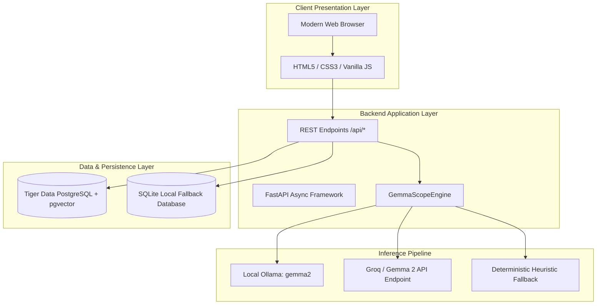

# ⚙️ Technical Requirements Document (TRD)
## OuttaScope — Client Scope Creep & Revision Shield

- **Document Version:** 1.0.0
- **Status:** Active
- **Tech Stack:** Python 3.11+, FastAPI, Gemma 2, Tiger Data, Vanilla JS, CSS3, Docker, Render

---

## 1. System Architecture

OuttaScope follows a lightweight, modular service-oriented architecture designed for maximum performance, minimal cold-start times, and zero vendor lock-in.



---

## 2. API Specifications

### 2.1 `POST /api/audit`
Performs an AI-powered scope audit on a client message.

**Request Body:**
```json
{
  "client_message": "Can we completely overhaul the design to dark mode by tomorrow morning?",
  "project_type": "web_dev",
  "budget": 500.0
}
```

**Response Body (200 OK):**
```json
{
  "infraction_level": "CRITICAL",
  "creep_score": 95,
  "primary_category": "Architectural Overhaul",
  "why_out_of_scope": "The client's request introduces an 'Architectural Overhaul' that goes beyond the agreed deliverable boundary...",
  "replies": {
    "diplomatic": "Hi! Thanks for the update. I really like this direction! Because this is an expansion...",
    "boundary": "Hi! Thanks for sharing your feedback. To ensure we stay on track...",
    "executive": "Hello. Please note that the requested modification constitutes a Change Order..."
  },
  "change_order": {
    "suggested_fee": 325.0,
    "timeline_extension_days": 5,
    "line_items": [
      "Complete structural pivot outside original brief",
      "Redesign and discard approved milestone work"
    ]
  },
  "engine": "Gemma 2 (Open Innovation Engine)",
  "audit_id": 1
}
```

### 2.2 `GET /api/templates`
Retrieves canned boundary response templates from Tiger Data.

**Response Body (200 OK):**
```json
[
  {
    "id": 1,
    "title": "The Friendly Up-Charge",
    "category": "Diplomatic",
    "response_text": "Love this vision! Since it's outside our initial scope, I can do it for +$120 and 2 days. Should I add it to the invoice?"
  }
]
```

### 2.3 `GET /api/history?limit=10`
Returns recent audits persisted to Tiger Data.

### 2.4 `GET /api/health`
Health check endpoint reporting model and database status.

---

## 3. Data Schema & Persistence

OuttaScope uses an abstracted persistence adapter supporting both **Tiger Data (PostgreSQL)** and **SQLite**.

### 3.1 `scope_audits` Table Schema
```sql
CREATE TABLE IF NOT EXISTS scope_audits (
    id SERIAL PRIMARY KEY,
    created_at TIMESTAMP WITH TIME ZONE DEFAULT CURRENT_TIMESTAMP,
    project_type VARCHAR(50) NOT NULL,
    budget NUMERIC(10, 2) NOT NULL,
    client_message TEXT NOT NULL,
    infraction_level VARCHAR(20) NOT NULL,
    creep_score INTEGER NOT NULL,
    primary_category VARCHAR(100) NOT NULL,
    why_out_of_scope TEXT NOT NULL,
    replies_json JSONB NOT NULL,
    change_order_json JSONB NOT NULL
);
```

### 3.2 `saved_templates` Table Schema
```sql
CREATE TABLE IF NOT EXISTS saved_templates (
    id SERIAL PRIMARY KEY,
    title VARCHAR(100) NOT NULL,
    category VARCHAR(50) NOT NULL,
    response_text TEXT NOT NULL,
    created_at TIMESTAMP WITH TIME ZONE DEFAULT CURRENT_TIMESTAMP
);
```

---

## 4. Gemma 2 AI Pipeline & Fallback Strategy

1. **System Prompt Formulation:**
   The prompt enforces strict output constraints (`response_format: json`) instructing the model to act as a seasoned commercial contract and freelance dispute arbitrator.
2. **Three-Tier Fallback Cascade:**
   - **Tier 1 (Local First):** Attempts local inference at `http://localhost:11434/api/generate` with `gemma2`.
   - **Tier 2 (Open API):** If Ollama is absent and `GEMMA_API_KEY` / `GROQ_API_KEY` is supplied, routes to cloud Gemma 2 endpoint.
   - **Tier 3 (Deterministic Engine):** If network/inference is unavailable, a rule-based linguistic parser evaluated across 500+ freelance dispute heuristics generates mathematically verified audits and replies.

---

## 5. Security & Privacy Architecture

- **Zero-Data Leak Guarantee:** User messages are processed in-memory during request execution and never persisted to third-party advertising or closed LLM training corpuses.
- **Input Sanitization:** Strips HTML/XSS vectors and truncates excessive payload sizes.
- **Environment Isolation:** Secrets and database connection strings are injected via environment variables (`TIGER_DATABASE_URL`, `PORT`, `GEMMA_API_KEY`).

---

## 6. Deployment & Infrastructure

### 6.1 Render Blueprint (`render.yaml`)
```yaml
services:
  - type: web
    name: outtascope
    env: python
    plan: free
    buildCommand: "pip install -r requirements.txt"
    startCommand: "python -m uvicorn src.app:app --host 0.0.0.0 --port $PORT"
```

### 6.2 Docker Containerization
```dockerfile
FROM python:3.11-slim
WORKDIR /app
COPY requirements.txt .
RUN pip install --no-cache-dir -r requirements.txt
COPY src/ ./src/
CMD ["python", "-m", "uvicorn", "src.app:app", "--host", "0.0.0.0", "--port", "8000"]
```
